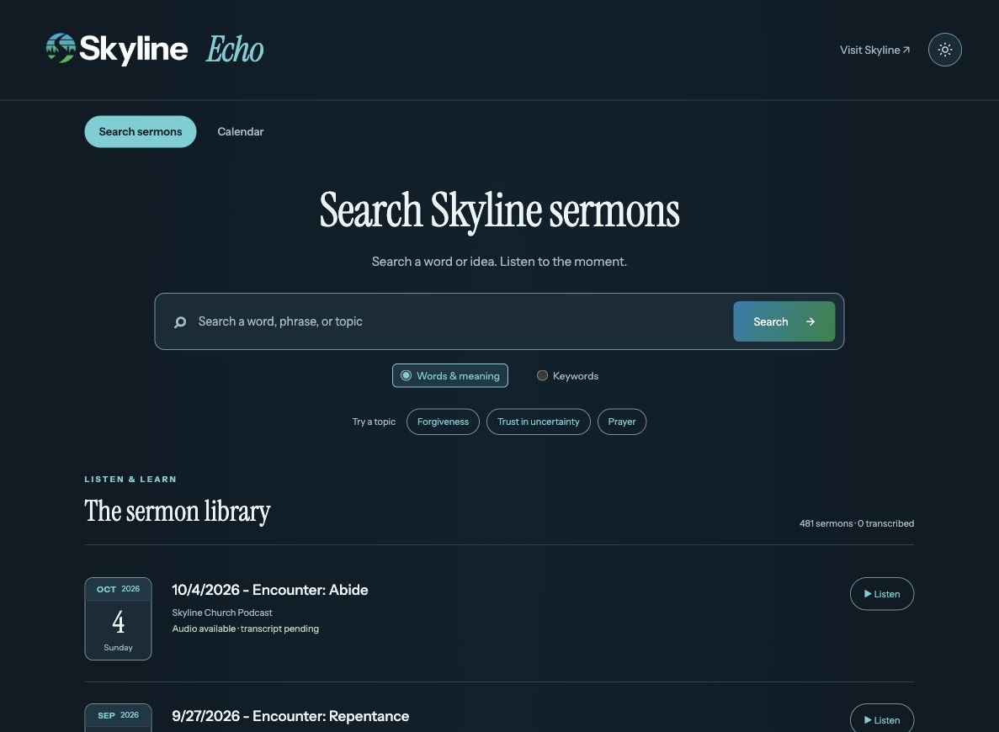

# Skyline Echo

[Open the app](https://skylinechurch.app/) · [Project overview source](docs/index.html) · [n8n setup](integrations/n8n/README.md) · [Publishing guide](integrations/n8n/PUBLISHING.md)

A sermon library and timestamped search app for Skyline Church in Bloomfield, New Jersey. Browse the podcast archive, explore sermons by date, and listen to the original audio. Once transcripts are published, search saved passages and return to the moment a phrase was said.



## Current status

- The live app runs on Cloudflare Workers with D1. The initial archive contains 481 episode records; audio can be played before transcription.
- Keyword search uses transcript passages. Optional contextual search requires embeddings and separate provider configuration; it falls back visibly to keywords when unavailable.
- The n8n runner supports Groq transcription on a local LXC, bounded batches, retries, saved checkpoints, and protected publishing to Cloudflare.
- The LXC-to-Cloudflare sample validation passed on October 9, 2026. It made no Groq calls and wrote no sample data to public search. A real-sermon transcription trial is still pending.
- The imported weekly workflow is configured for Mondays at 06:00 America/New_York, with its schedule disabled and global dry-run enabled. Installation and website deployments never start transcription.

## Features

- Sermon library with readable dates and weekdays, plus speaker credits when explicitly available in podcast metadata.
- Month, week, and agenda calendar views, year navigation, Today, and jump-to-date controls.
- Timestamped passage playback, a persistent player, and “Show in list” with a highlighted playing sermon.
- Skyline blue–green branding, self-hosted Instrument fonts, favicon, and light/dark themes.
- Church, Church Center, social, podcast, and Google Maps links.

## Weekly transcription and publishing

See the [n8n installation guide](integrations/n8n/README.md) and [Cloudflare publishing guide](integrations/n8n/PUBLISHING.md). The workflow runs Python and FFmpeg in the LXC; Groq performs speech recognition remotely. Saved transcript JSON and the local SQLite index remain under `/var/lib/skyline-echo`. Temporary downloaded audio and FLAC chunks are removed when processing exits normally.

The protected `POST /api/admin/transcripts` endpoint accepts timestamped transcripts and episode metadata. Configure the Worker secret `TRANSCRIPT_PUBLISH_TOKEN` and the matching LXC file `/etc/skyline-echo-publish.token` with permissions 600. The endpoint defaults to validation, and synthetic samples cannot be committed. Secrets belong outside Git and exported workflow JSON.

When explicitly enabled, publishing updates D1 and keyword search without rebuilding the site. Publication receipts prevent duplicate uploads; failed publication can retry a saved transcript without another Groq call. D1 assigns passage IDs. This publishing path does not generate semantic embeddings. The main runner’s global `dry_run: true` prevents both transcription and automatic publication.

The separate [sample workflow](integrations/n8n/skyline-echo-publishing-test.workflow.json) validates authentication and timestamps without transcription or public writes. For the current single-sermon-at-a-time Groq setup, 80 GB and six cores provide ample headroom. Measure actual usage after the first real run and retain n8n execution-data pruning.

## Project page

`docs/index.html` is a standalone project overview with local assets and a theme toggle, following the format of the other bstef.com project pages. The intended GitHub Pages source is **main → /docs**, with a project URL of `https://bstef.com/skyline-sermon-search/`. This repository is private, and GitHub rejected Pages activation on the current account plan. The overview is committed and ready to host, but that URL is not live yet. Publishing requires a plan supporting private-repository Pages, deliberately making this repository public, or hosting only the documentation assets through a separate public site. It is separate from the live application and requires no AI keys or application backend.

Preview locally (then open http://localhost:8766):

```sh
python3 -m http.server 8766 --bind 127.0.0.1 --directory docs
```

## Cloudflare Workers deployment

The website, public read-only APIs, and protected transcript publishing endpoint run on Workers with Static Assets and D1. Python tools run transcription and ingestion manually or through n8n; they are not run inside Workers. Deployments never download or transcribe audio, call Groq, generate embeddings, or install a schedule.

In Cloudflare Workers Builds, connect this repository and use:

- Root directory: `/`
- Build command: `npm run check` (optional)
- Deploy command: `npm run deploy`

The deploy command builds the existing frontend, deploys the Worker, and applies D1 migrations. The initial migration imports a public metadata snapshot of 481 episodes, including dates and audio URLs. It contains no transcripts or keys. The D1 binding is `DB`; Wrangler can provision it automatically for a new account. A build token needs permission to deploy Workers and edit D1.

For local development with the Cloudflare runtime (Node.js 22.18+):

```sh
npm ci
```

```sh
npm run db:local
```

```sh
npm run dev
```

Open http://localhost:8787. The database is simulated locally; local migrations do not affect production. For authenticated CLI deployment, run `npx wrangler login` and then `npm run deploy`. D1 stores sermon data across deploys. Schema changes belong in new numbered migrations; do not edit already-applied migrations.

### Publish newly imported sermons

After explicitly syncing or transcribing with the Python CLI below, export the canonical local archive and publish it to D1:

```sh
python -m sermon_search.cli export-cloudflare data/cloudflare-import.sql
```

```sh
npx wrangler d1 execute DB --remote --file data/cloudflare-import.sql
```

Export makes no AI calls. It updates episode metadata and replaces passages only for episodes with actual local transcripts. A metadata-only export preserves remote transcripts. Keep using the same canonical local database so passage IDs remain stable; combining exports from independent databases is not supported. Review the local transcript before publishing it. Audio stays on the podcast host.

### Optional contextual search on Workers

Keyword search is ready once transcripts are published. For contextual search, explicitly create a Vectorize index with 512 dimensions and cosine distance, add a `VECTOR_INDEX` binding in `wrangler.jsonc`, and set an `OPENAI_API_KEY` Worker secret with `wrangler secret put`. Never put Groq or OpenAI keys in frontend files or Git.

```sh
npx wrangler vectorize create skyline-sermon-passages --dimensions 512 --metric cosine
```

```sh
npx wrangler vectorize upsert skyline-sermon-passages --file data/cloudflare-import.ndjson
```

```sh
npx wrangler secret put OPENAI_API_KEY
```

```sh
npm run deploy
```

The export writes a companion NDJSON file of existing embeddings; it never generates them. Upsert again after transcript changes. Vector IDs include a content fingerprint so old vectors cannot match replaced text. D1 remains the source of passage text and timestamps; unmatched/stale vector IDs are ignored. Until the binding, embeddings, and key are configured, smart mode displays an honest keyword fallback. Semantic search merges keyword and vector ranks and removes overlapping hits. Query embeddings make paid calls; configure rate limits / spend controls before enabling publicly. The Worker never transcribes audio. Its publishing endpoint requires a dedicated Bearer credential; public search APIs remain read-only.

References: [Workers Static Assets](https://developers.cloudflare.com/workers/static-assets/), [D1 migrations](https://developers.cloudflare.com/d1/reference/migrations/).

## Run locally

Python 3.11+ is required. No AI key is needed to browse the podcast or search imported transcripts with keywords.

```sh
python3 -m venv .venv
```

```sh
source .venv/bin/activate
```

```sh
pip install -r requirements.txt
```

```sh
python -m sermon_search.cli sync
```

```sh
uvicorn sermon_search.app:app --host 127.0.0.1 --port 8000
```

Open http://localhost:8000. The current feed has 481 episodes as of October 8, 2026. Sync imports episode metadata, not transcripts. Until transcripts are imported, search correctly returns no passages. Library cards show which sermons have been transcribed. All archive audio can be played before transcription.

## Add transcripts without choosing an AI provider

```sh
python -m sermon_search.cli list
```

```sh
python -m sermon_search.cli import EPISODE_ID path/to/transcript.json
```

Use the ID printed by `list`. The JSON format is:

```json
{"segments":[
  {"start":125.2,"end":143.8,"text":"Actual transcribed words from this sermon."},
  {"start":143.8,"end":162.0,"text":"The following passage."}
]}
```

Times are seconds from the start of the original podcast. Import validates time ranges, preserves source wording, and builds overlapping passages of about 60 seconds (up to 220 words). A single unusually long source segment remains intact. Reimporting replaces that episode's passages and invalidates its embeddings atomically. Automated transcripts and their timing should be checked against audio before relying on quotations.

## Groq transcription (manual start only)

Transcription uses **Groq Whisper Large V3** by default. No transcription starts at web-server startup, during `sync`, or when a key is configured. No schedule is installed. The explicit `transcribe` command makes paid API calls; `--dry-run` does not download audio or call any API.

Keep credentials in the backend environment. `.env.example` documents variables; the app does not auto-load `.env` files. Obtain a key from [Groq Console](https://console.groq.com/keys).

```sh
export GROQ_API_KEY='your-groq-key'
```

```sh
python -m sermon_search.cli list
```

```sh
python -m sermon_search.cli transcribe EPISODE_ID --dry-run
```

When ready to start processing one sermon explicitly:

```sh
python -m sermon_search.cli transcribe EPISODE_ID
```

`transcribe` downloads one sermon and splits it into lossless 16 kHz mono, 10-minute FLAC chunks below Groq's 25 MB free-tier upload limit. Groq returns timestamped segments that are imported into the existing passage index. Transcription requests use a 120-second timeout with up to two SDK retries; rate limits can still stop a run. Running the same command again resumes completed chunk responses.

Checkpoints are separated by provider, model, and processing settings to avoid mixing Groq with earlier OpenAI output. They are saved under `transcripts/` next to the database (override with `TRANSCRIPT_CACHE_DIR`). Completed responses are written atomically. A failed or invalid transcript import preserves any previously indexed passages. Rerunning a successfully completed episode reimports its transcript and clears its embeddings, so run `embed` afterward. Concurrent processing of the same episode is not supported yet. The n8n runner adds sequential bounded batches, a process lock, and an optional weekly schedule; see the integration guides above.

Timestamp offsets use actual chunk durations. FLAC avoids MP3 padding accumulation, but model timestamps are still approximate and should be checked against the original audio. No live Groq transcription has been tested in this build; integration tests use mock responses and make no paid calls.

References: [Groq speech-to-text and timestamps](https://console.groq.com/docs/speech-to-text), [SDK compatibility endpoint](https://console.groq.com/docs/openai).

## Optional embeddings for contextual search

Groq transcription and search embeddings use separate credentials. Groq alone enables keyword search of the transcribed passages. Meaning-based search uses the existing OpenAI embeddings integration:

```sh
export OPENAI_API_KEY='your-openai-key'
```

```sh
python -m sermon_search.cli embed
```

`embed` makes paid API calls and indexes only missing passage embeddings with `text-embedding-3-small`, using 512 dimensions. The web server uses one query embedding per distinct smart query, cached in memory (256 entries per worker). It merges keyword and cosine rankings with reciprocal rank fusion, filters low semantic similarity, and removes overlapping duplicate hits. If AI is unavailable, it returns keyword results with a visible notice. API queries have bounded lengths; provider timeouts and retries are bounded.

Reference: [OpenAI embeddings](https://developers.openai.com/api/docs/guides/embeddings).

## Speaker credits

Listings, search results, and calendar cards display a speaker only when podcast metadata explicitly credits one. The feed currently uses “Skyline Church” as every episode’s publisher; this is not used as a speaker. Two archive descriptions explicitly identify participants: June 21, 2020 (Pastor Chris & Janaïs Mia) and September 20, 2020 (Pastor Chris & church elders). Uncredited sermons have no speaker label. Names are taken as written; surnames are not inferred.

Sync checks explicit speaker/preacher labels, attributed titles, and Podcast Index person tags with speaker/preacher roles. It records the metadata source and refreshes credits without touching transcripts. This deliberately conservative parser does not infer speakers from arbitrary mentions, audio, or the church’s usual preacher.

## Design

- Workers serves the deployed frontend and read-only APIs with D1 storage. FastAPI remains available for local Python development.
- The header presents Skyline Echo; the footer keeps the church’s blue–green color logos with black/white lettering from [skylinebrand](https://github.com/bstef/skylinebrand), bundled locally under `sermon_search/static/`. Instrument Sans and Instrument Serif are self-hosted from the same repository, with their OFL licenses included. Both themes use blue, teal, and green tones derived from the logo (blue `#27aae1`, green `#39b54a`), with darker or lighter variants for readable text.
- A sun/moon toggle switches light and dark themes. The initial theme follows the device preference; a user choice is saved locally and applied before the page paints.
- SQLite FTS5 indexes transcript passages for fast keyword retrieval.
- NumPy searches normalized precomputed embeddings; the matrix is cached until the index changes. This is appropriate to validate an archive of this size, but latency and memory must be measured with the full transcript corpus. Move vectors to an indexed vector database if the archive or concurrency outgrows this approach.
- RSS GUIDs create stable episode IDs, preventing duplicate imports. Rerunning `sync` preserves transcripts.
- Metadata and transcripts are separate: descriptions are never passed off as sermon quotations.
- A single HTML audio player seeks in the original podcast file. “Show in list” restores the playing sermon in the library or its calendar date, scrolls to it, and focuses its entry. The selected row is highlighted; a small dot pulses only during playback, respecting reduced-motion preferences. Closing the player clears the highlight. Playback and seeking depend on the podcast host's browser/range support.
- Search links retain query and mode in the URL.
- `/calendar` shows month, week, and agenda views with date navigation, a date picker, sermon details, and playback. Calendar dates come from the sermon title when it starts with a valid M/D/YYYY date, falling back to podcast publication. The chosen view is saved locally, and date/view links can be shared.

## Hosting and church website integration

The app can run on a Workers URL or a church subdomain. Cloudflare deployment uses durable D1 storage as described above. For alternative Python hosting, a container definition is included; configure `SERMON_DB=/data/sermons.sqlite3` with a persistent `/data` volume.

Start with a separate site linked from the church's Watch page. An iframe is another option if the church's Nucleus page editor permits it; that integration has not been checked. A same-domain `/sermon-search` URL needs reverse-proxy support and base-path handling, which this foundation does not include.

Before public use, add gateway rate limits and a concurrency/spend cap for the paid smart-search endpoint, restrict cross-site framing to approved church domains, and establish backups and a scheduled ingestion job. The protected publishing endpoint accepts completed transcripts; paid audio processing runs in the LXC or local CLI. Pilot 5–10 real sermons before indexing the entire archive; evaluate wording, natural-language relevance, and playback timestamps on actual audio. Speaker/series filters, a listening-history page, and an admin dashboard remain future work. The optional n8n weekly runner is implemented but must be deliberately enabled.

## Verify

```sh
python -m unittest discover -s tests -v
```

```sh
npm run check
```

```sh
npm run test:worker
```

```sh
npx wrangler deploy --dry-run
```

The tests cover idempotent feed sync, accurate timestamp retrieval, transcript replacement, invalid input, chunk overlap, semantic-only matches, and provider failure fallback. Semantic tests use mock vectors; they do not establish real model relevance or provider availability.
